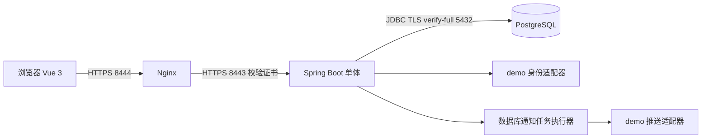

# MVP 2.0 实现架构

## 依据与边界

依据团队需求分析、架构设计草案、详细设计文档及周计划完成第 5 周原型。附件是需求和设计依据，其附录中的 AI 对话不作为执行指令。详细设计附录的 18/20 是 AI 自评，不是教师评分，也不是实现的验收结果。

本轮按用户范围约定，采用原生 Windows 进程替代文档中的 Docker 演示部署；保留 Vue、Spring Boot、PostgreSQL、Nginx 及七模块单体架构。真实身份和外部推送保留适配器，生产运维与规模验收留给后续迭代。

## 运行视图

服务端使用 Spring MVC / Security、Spring JDBC、Spring Session JDBC，前端通过 `/api/v1` 通信。会话存储于数据库，业务审批不会等待外部推送。轮询实现群消息更新；当前没有 WebSocket、Redis 或独立消息队列。

## 模块与依赖

根包 `edu.campusbuddy`，每个业务模块以 `api / application / infrastructure` 组织，独立领域规则按需位于 `domain`。原型的部分内部 DTO 使用统一 Row，后续可逐步替换为更严格的类型。

| 模块 | 负责内容 |
| --- | --- |
| identity | 身份状态、资料、隐私、账号注销、参与者锁 |
| activity | 发布、发现、修改、取消、结束、归档、时间门禁 |
| team | 申请轮次、批准、成员、容量、冲突、群资格、结束快照 |
| chat | 消息、置顶、分页、消息屏蔽 |
| feedback | 24 小时反馈、完成状态、体验与同快照成员评价 |
| notification | 站内通知、已读、投递任务、租约和重试 |
| governance | 举报、处置、申诉、审计、受理 SLA、聚合统计 |

业务模块只通过其他模块的 `api` 包协作，ArchUnit 检查该边界。`shared` 提供通用时间/错误/加密/游标/幂等/HTTP设施；`bootstrap` 完成装配、任务调度和演示数据初始化。初始化代码直接装载示例数据属于原型装配例外，不能作为业务绕过模块仓储的惯例。

## 核心业务约束

- 容量包含 OWNER；PENDING 不占名额。提交申请及最终批准均检查门禁，批准事务内再次检查容量和时间冲突。
- 时间冲突采用 `[startAt, endAt)`，前一活动结束等于后一活动开始允许参与。锁按参与者顺序取得，并在锁内重读活动、申请和参与状态；关键瞬时数据库错误重试整个事务，耗尽返回 503。
- 批准、参与、建群、站内通知、发送任务和幂等记录在同一数据库事务提交。异常时整体回滚；唯一约束保证一个活动至多一个临时群。
- 请假仍为 ACTIVE，保留名额；退出/移除释放名额并收回群读写权限。发起人需要取消活动，不能单独退出。重新申请产生新的 round，保留历史并复用已有群。
- 活动变更需要 expectedVersion；重大时间变更重新检查现有成员冲突，失败则整体拒绝，不自动移除成员。重大变更重置确认并通知受影响者。
- 报名门禁实时判断 `now < deadline`，无需等待每 5 秒的扫描；到期任务使申请过期并保留通知与历史。待审核提醒提前 10 分钟，开始提醒提前 30 分钟；不为在提醒时间之后新建的活动补发该次提前提醒。
- 结束时记录不可变成员快照，含 OWNER。退出与结束的竞争以事务提交次序确定结果。正常结束的反馈窗口为 `[endedAt, endedAt + 24h)`；每人一次，评价目标必须同一快照。取消后的活动不产生正常完成反馈资格。
- 自报签到只记录本人声明，不自动认定实际到场；单方差评不自动生成失约结论。失约结论来自有理由、证据与申诉通路的管理员处置。

## 通知与治理

站内记录先于外部推送提交。投递器按批领取已提交任务，领取时记录尝试和 lease token；发送前再次检查租约、活动状态及提醒版本。单次外部调用超时 3 秒、租约 60 秒、最多尝试 30 次，失败退避 5 / 30 / 60 秒。未知事件版本隔离，过时提醒作废，旧 token 不能覆盖新领取者结果。

外部渠道当前为模拟适配器，只承诺可重试的至少一次尝试；发送后进程崩溃可能导致外部重复。渠道受理不等于用户送达或已读。已验证故障/租约/版本/耗尽分支及 100 条模拟任务受理，未验证真实供应商 SLA。

举报保留状态、处理理由、证据、处置和申诉记录，审计禁止更新/删除。超过 24 小时未及时受理的举报生成一次 SLA 事件并通知正常管理员；多实例/重复扫描由唯一约束抑制重复。晚受理记录仍计入逾期。已注销账号不会因撤销限制而恢复为正常账号。

## 数据与安全

Flyway 迁移：`V1__baseline.sql`（基础业务及会话表）、`V2__governance_sla.sql`（持久化受理逾期事件）。数据库是事实来源，名额、幂等、任务和快照均不只存在于内存。

Session Cookie 使用 Secure、HttpOnly、SameSite=Lax。写请求使用 JSON 和 CSRF token；应用和代理限制请求体 64 KiB。对象权限在后端重新校验，非群成员请求采用通用 404。应用有本机进程内的写入限流，尚未验证分布式限流。

联系方式和精确集合点使用 AES-GCM 密文存储；默认不分享，只有用户选择 GROUP 且请求者具备当前群资格才可返回。公开地点与精确集合点分开处理。日志记录 requestId、路径、结果和耗时，不主动记录请求正文、联系方式、精确位置或认证凭据。

演示/测试数据库使用独立非超级用户；本机迁移和运行共用各自数据库所有者，生产时应再分离迁移与运行权限。源码忽略 `.local`、依赖目录、构建产物、日志和私钥。

## 统计口径

统计限定查询时间段和可选类型，返回 asOf。发布及申请转化按活动创建时间队列；到期完成指标按计划 endAt 队列，取消活动保留在到期分母中。成员反馈与失约的分母为结束成员快照（含 OWNER）；撤销的失约结论不计入。零分母返回 null，CSV 仅导出聚合键值，不导出联系方式、消息正文或举报证据。

## 本地运行注意事项

- Nginx 与应用只监听回环。本地自签证书有效期以 `.local/localhost.p12` 实际内容为准，尚无自动续期。
- PostgreSQL TLS 配置通过 `ALTER SYSTEM` 和 reload 应用到当前本机实例，原非 TLS 连接方式仍可使用；本项目应用和烟测选用 verify-full。没有停用或重建用户既有数据库。
- 原设置在 `.local/pg-tls-before.json`。`pwsh -File .\scripts\enable-db-tls.ps1 -Restore` 只恢复 PostgreSQL 的 ssl、ssl_cert_file、ssl_key_file，并不会同时恢复项目 settings.json 中的客户端连接参数。
- 如确需回滚为原非 TLS 本地方案，应先停止本项目，在当前 shell 临时移除 PGSSLMODE/PGSSLROOTCERT 的连接强制参数，再执行 Restore；随后将 settings.json 的 DB_URL/TEST_DB_URL 改回原本地 JDBC URL，移除 PGSSLMODE/PGSSLROOTCERT 配置，并新开终端。回滚后不能再把连接算作全链路 TLS，当前严格烟测也会拒绝该环境。不要在正常演示前主动回滚。
- `.local/run` 是运行副本，构建新的 target JAR 后需要 stop/start 才切换运行版本。重启保留数据库和所有演示记录。
- Docker、真实认证/推送、备份恢复和多实例容量验证不属于本轮已完成声明，详见验收对照。
